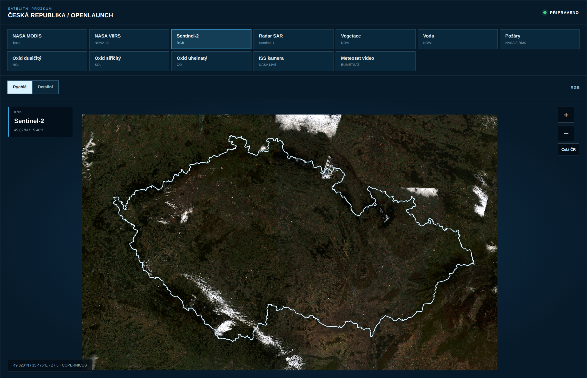
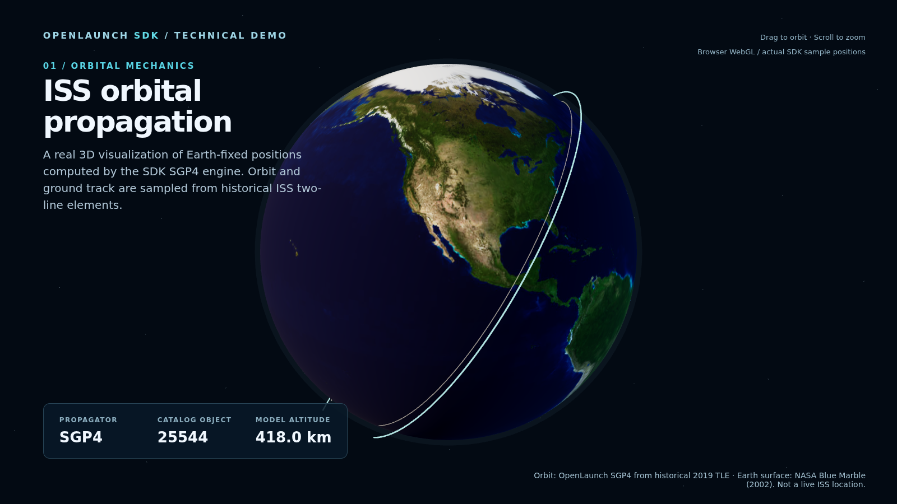
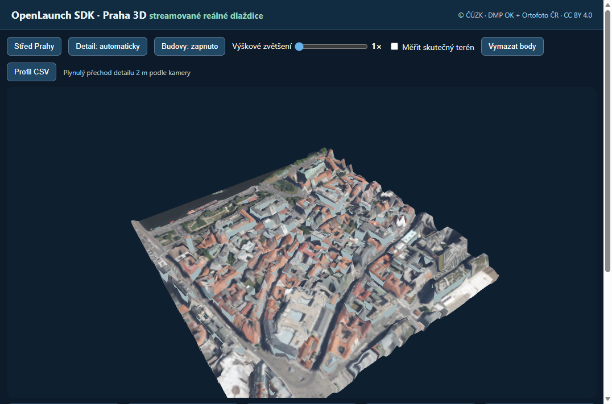
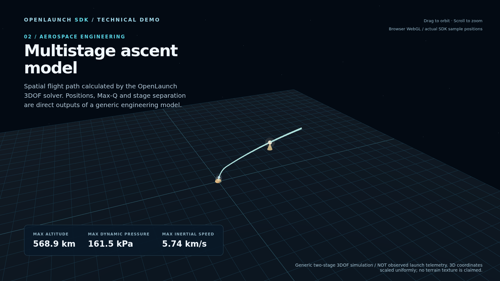
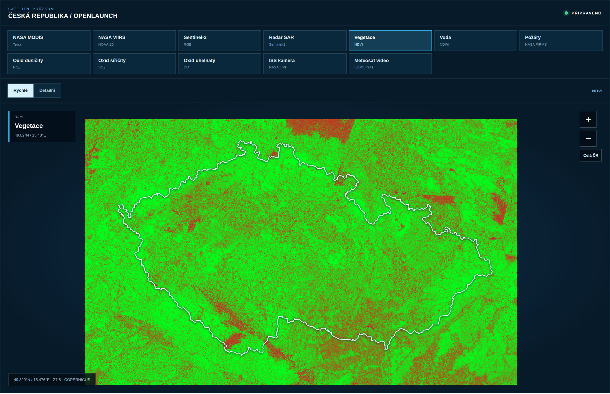
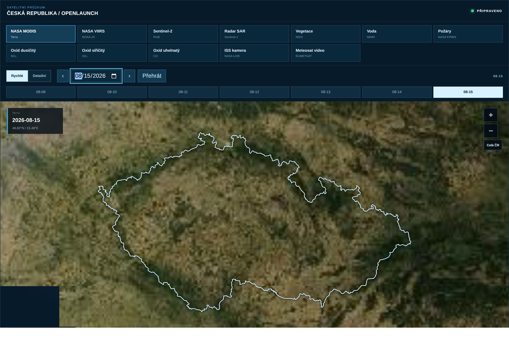
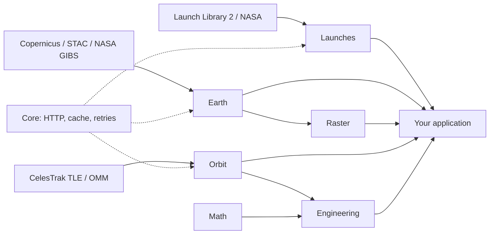

# OpenLaunch SDK

[](https://www.npmjs.com/package/openlaunch-sdk)
[](https://www.npmjs.com/package/openlaunch-sdk)
[](LICENSE)

**Spaceflight data, satellite tracking, Earth observation, and aerospace engineering in TypeScript.**

OpenLaunch brings together data from space-related providers and tools for working with it: launch schedules, satellite orbits, Earth imagery catalogs, georeferenced raster analysis, mission planning, and engineering simulations.

Use the complete SDK or install just the packages your project requires.

[Get started](#quick-start) · [Explore capabilities](#what-you-can-build) · [Choose a package](#packages) · [Real SDK showcase](#see-openlaunch-sdk-in-action) · [Browse examples](examples/README.md) · [Documentation](#documentation)

## What you can build

| Area | What OpenLaunch provides | Start here |
| --- | --- | --- |
| **Earth observation** | Discover Sentinel and Landsat scenes by location and date; work with NASA GIBS, Meteosat, and other map data sources. | [Earth observation examples](examples/13-earth-observation/) |
| **Raster and terrain analysis** | Read supported GeoTIFF/COG data, calculate NDVI and other indices, apply quality masks, compare observations, and build local DEM meshes. | [Raster examples](examples/17-raster/) |
| **Satellite tracking** | Propagate TLE/OMM orbits with SGP4/SDP4, calculate ground tracks and passes, and export 3D scenarios as CZML. | [Orbit and traffic examples](examples/14-orbit-traffic/) |
| **Launch data** | Query upcoming and historical launches, launch vehicles, agencies, astronauts, events, and launch pads. | [Launch data examples](examples/01-launch-library/) |
| **Rocket engineering** | Explore multistage ascent, guidance, Max-Q, staging, and Monte Carlo dispersion with research-grade models. | [Trajectory examples](examples/15-launch-trajectory/) |
| **Mission engineering** | Combine orbital calculations, spacecraft sizing, sensor geometry, and observation planning. | [Integrated mission examples](examples/11-integrated-missions/) |
| **Scientific computing** | Work with vectors, matrices, quaternions, numerical methods, controls, atmospheric models, and aerospace formulas. | [Mathematics examples](examples/07-gnc-math/) |

## See OpenLaunch SDK in action

These are **actual application screenshots and SDK-computed visualizations**, not stock pictures or generated decorative dashboards. OpenLaunch is a TypeScript library: the browser interfaces shown here are examples built *using* it, rather than a built-in UI.

### Earth observation — real Sentinel-2 imagery

[](https://www.kobylkadavid.cz/?utm_source=chatgpt.com)

The [interactive satellite explorer on kobylkadavid.cz](https://www.kobylkadavid.cz/) uses SDK-backed endpoints for Copernicus and NASA observation data. This is real Sentinel-2 RGB imagery in a working map interface with geographic alignment and source selection, not a replacement photograph.

### Orbital mechanics and real 3D terrain

| **ISS orbit — SGP4 propagation** | **Prague — measured 3D terrain (experimental)** |
| --- | --- |
| [](examples/14-orbit-traffic/10-czml-3d-scenario.ts) | [](https://github.com/kobyldav/openlaunch-sdk/tree/feature/terrain-prague-real-dem) |
| **Orbit & traffic:** actual SDK-propagated Earth-fixed orbit positions and ground track from a historical 2019 ISS TLE; Earth texture uses NASA Blue Marble. [Propagation and CZML](examples/14-orbit-traffic/10-czml-3d-scenario.ts) | **Terrain:** actual ČÚZK DMP OK elevations, Ortofoto ČR and 3D WebGL viewer. This capability is on the [experimental terrain branch](https://github.com/kobyldav/openlaunch-sdk/tree/feature/terrain-prague-real-dem), **not** the published main SDK. [Terrain documentation](https://github.com/kobyldav/openlaunch-sdk/blob/feature/terrain-prague-real-dem/docs/TERRAIN_REAL_3D.md) |

### Ascent simulation and satellite analytics

| **Multistage launch engineering** | **Sentinel-2 vegetation index (NDVI)** |
| --- | --- |
| [](examples/15-launch-trajectory/01-multistage-flight.ts) | [](https://www.kobylkadavid.cz/) |
| **Engineering:** spatial path calculated by `simulateLaunch()`, with Max-Q and stage events. The model is **illustrative**, not a real rocket's flight telemetry. [Launch trajectory examples](examples/15-launch-trajectory/) | **Raster processing:** a genuine Copernicus processed NDVI layer in a deployed web application, not an invented spectral fixture. [Raster examples](examples/17-raster/) |

<details>
<summary>Another real provider view: NASA Terra MODIS</summary>

[](https://www.kobylkadavid.cz/)

Daily NASA GIBS map tiles, requested for 2026-08-15; the precise acquisition date of each pixel is not independently verified.

</details>

All model screenshots can be reproduced through the [3D showcase guide](docs/SHOWCASE.md) and `npm run showcase`; live site screenshots through [`npm run gallery`](docs/README_GALLERY.md). The 3D examples show **what you can build with the SDK's computed outputs**, not built-in SDK windows. For the broader API surface, browse [the runnable example catalog](examples/README.md).

## Quick start

**Requirements:** Node.js 18 or newer and npm.

Install the complete SDK:

```bash
npm install openlaunch-sdk
```

Create `launch.mjs`:

```js
import { OpenLaunch } from "openlaunch-sdk";

const space = new OpenLaunch();
const launch = await space.launches.next();

if (!launch) {
  console.log("No upcoming launch found.");
} else {
  console.log({
    name: launch.name,
    date: launch.net.toISOString(),
    status: launch.status.name,
    rocket: launch.rocket?.fullName ?? launch.rocket?.name,
    launchPad: launch.pad?.name,
  });
}
```

Run it:

```bash
node launch.mjs
```

This example requests data from Launch Library 2. Results depend on provider availability and rate limits. See the [getting-started examples](examples/00-getting-started/) for more.

### A second example: explore Earth map layers

Only need Earth observation features? Install the Earth module without the rest of the SDK:

```bash
npm install @openlaunchsdk/earth
```

```js
import { SpaceMapClient } from "@openlaunchsdk/earth";

const maps = new SpaceMapClient();

const layers = maps.layers("observations");
console.table(
  layers.map(({ id, label, provider }) => ({ id, label, provider }))
);

const daily = maps.webMapDaily({
  layer: "nasa-modis-terra",
  date: "2026-10-17",
});

console.log(daily);
```

The layer catalog can be used offline. `webMapDaily()` returns a provider-backed map **descriptor**, not verified image bytes or proof of an acquisition on the requested date. For actual tile delivery and verified previews, see the [web integration examples](examples/19-web-integration/).

## Packages

OpenLaunch v1.22.1 is published as seven focused packages plus the backward-compatible `openlaunch-sdk` umbrella package.

| Package | Install when you need |
| --- | --- |
| [`@openlaunchsdk/core`](https://www.npmjs.com/package/@openlaunchsdk/core) | HTTP transport, caching, retries, rate limits, and shared models. |
| [`@openlaunchsdk/earth`](https://www.npmjs.com/package/@openlaunchsdk/earth) | Earth observation catalogs, satellite map layers, weather, and scene discovery. |
| [`@openlaunchsdk/raster`](https://www.npmjs.com/package/@openlaunchsdk/raster) | GeoTIFF/COG reading, spectral indices, quality masks, and terrain meshes. |
| [`@openlaunchsdk/launches`](https://www.npmjs.com/package/@openlaunchsdk/launches) | Launch Library 2 and NASA launch-related data. |
| [`@openlaunchsdk/orbit`](https://www.npmjs.com/package/@openlaunchsdk/orbit) | Satellite propagation, ground passes, space-traffic geometry, and CZML. |
| [`@openlaunchsdk/math`](https://www.npmjs.com/package/@openlaunchsdk/math) | Mathematics, numerical methods, controls, and scientific utilities. |
| [`@openlaunchsdk/engineering`](https://www.npmjs.com/package/@openlaunchsdk/engineering) | Rocket trajectories, engineering models, and mission simulations. |
| [`openlaunch-sdk`](https://www.npmjs.com/package/openlaunch-sdk) | The complete API and existing `OpenLaunch` imports. |

For example:

```bash
# Earth observation and raster analysis
npm install @openlaunchsdk/earth @openlaunchsdk/raster

# Launch schedules only
npm install @openlaunchsdk/launches

# Satellite tracking
npm install @openlaunchsdk/orbit
```

The scoped packages provide TypeScript declarations and ESM/CommonJS entrypoints. `@openlaunchsdk/orbit` uses `satellite.js` for SGP4/SDP4 propagation.

### How the parts fit together



These are separate libraries, not a hosted service or a visualization framework. The source providers, access requirements, and data licenses remain independent of OpenLaunch.

## Explore by use case

The repository includes a type-checked cookbook organized by task rather than by API name.

| Goal | Recommended starting point |
| --- | --- |
| Find the next rocket launch | [`00-getting-started/01-next-launch.ts`](examples/00-getting-started/01-next-launch.ts) |
| Search Sentinel-2 scenes | [`13-earth-observation/02-copernicus-sentinel2-search.ts`](examples/13-earth-observation/02-copernicus-sentinel2-search.ts) |
| Retrieve a NASA daily map tile | [`19-web-integration/02-verified-daily-tile.ts`](examples/19-web-integration/02-verified-daily-tile.ts) |
| Read a COG window | [`17-raster/01-real-cog-window.ts`](examples/17-raster/01-real-cog-window.ts) |
| Calculate a satellite pass over Prague | [`14-orbit-traffic/03-passes-over-prague.ts`](examples/14-orbit-traffic/03-passes-over-prague.ts) |
| Export an orbit for Cesium | [`14-orbit-traffic/10-czml-3d-scenario.ts`](examples/14-orbit-traffic/10-czml-3d-scenario.ts) |
| Simulate a multistage launch | [`15-launch-trajectory/01-multistage-flight.ts`](examples/15-launch-trajectory/01-multistage-flight.ts) |
| Create terrain geometry from DEM data | [`17-raster/04-terrain-mesh.ts`](examples/17-raster/04-terrain-mesh.ts) |
| Design an Earth-to-Mars transfer estimate | [`04-orbital-mechanics/06-earth-mars-hohmann.ts`](examples/04-orbital-mechanics/06-earth-mars-hohmann.ts) |

[All examples and recipes](examples/README.md) · [API export inventory](docs/EXPORTS.md)

## Data, accuracy, and limitations

OpenLaunch combines **real provider data** with **local calculations and illustrative engineering models**. Those are not interchangeable.

- **Observations:** STAC catalog metadata does not prove pixel availability, local cloud-free coverage, or image delivery. Use the supported binary-preview and QA workflows when you need those checks.
- **Raster processing:** Supported file formats, projections, codecs, and download limits are intentionally bounded. JPEG2000 requires a separately configured decoder for supported workflows.
- **Satellite orbits:** SGP4/SDP4 predictions depend on element quality and age. Geometric close approach is not a collision probability.
- **Launch simulations:** The 3DOF trajectory and spacecraft models are educational/research tools, not flight-qualified software or verified telemetry from an actual launch.
- **External services:** Some recipes require internet access, credentials, provider-approved hostnames, or application-level caching and rate limiting. Keep secrets on the backend.

See [Architecture](docs/ARCHITECTURE.md), [Validation](docs/VALIDATION.md), and the domain-specific guides below for technical boundaries.

## Run the examples and tests

From a local checkout:

```bash
git clone https://github.com/kobyldav/openlaunch-sdk.git
cd openlaunch-sdk
npm ci

npm run examples:check    # Type-check cookbook examples
npm run examples:offline  # Run network-free examples
npm run check             # Source, regression tests, and offline demos
```

Selected demos:

```bash
npm run example:raster
npm run example:live-earth
npm run example:launch
```

Offline examples may use synthetic or historical fixtures. Live provider behavior must be verified separately. For extended verification, see the [Fedora full-suite guide](docs/FEDORA_FULL_SUITE.md).

## Documentation

| Guide | Contents |
| --- | --- |
| [Examples](examples/README.md) | Runnable recipes organized by application and domain. |
| [Earth Intelligence](docs/EARTH_INTELLIGENCE.md) | STAC catalogs, Copernicus, Planetary Computer, and observation discovery. |
| [Web Map Integration](docs/WEB_MAP_V1_20.md) | Map scene search, provider descriptors, and preview delivery. |
| [Raster Processing](docs/RASTER_V1.md) | GeoTIFF/COG, calibration, spectral indices, quality masks, and DEM. |
| [Orbit & Space Traffic](docs/ORBIT_TRAFFIC.md) | SGP4/SDP4, passes, sensor geometry, traffic screening, and CZML. |
| [Launch Trajectory](docs/LAUNCH_TRAJECTORY.md) | Multistage launch simulation, guidance, Max-Q, and Monte Carlo. |
| [Mission Intelligence](docs/MISSION_INTELLIGENCE.md) | Mission workflows and modeled orbit-target diagnostics. |
| [Architecture](docs/ARCHITECTURE.md) | Internal components, dependency boundaries, and data flow. |
| [Validation](docs/VALIDATION.md) | Testing and accuracy considerations. |
| [Changelog](CHANGELOG.md) | Release history and version-specific changes. |

For detailed changes to satellite imagery delivery, caching, JP2 decoding, and QA, see the [full docs directory](docs/).

## Compatibility and contributions

The umbrella `openlaunch-sdk` package preserves the existing `OpenLaunch` API. New projects may use individual `@openlaunchsdk/*` modules to reduce unnecessary dependencies. See [Monorepo and packaging](docs/MONOREPO_V1_1.md) for details.

Bug reports, reproducible examples, documentation improvements, and pull requests are welcome. Please distinguish live provider data from synthetic fixtures, and keep the relevant checks passing.

**License:** [MIT](LICENSE).
